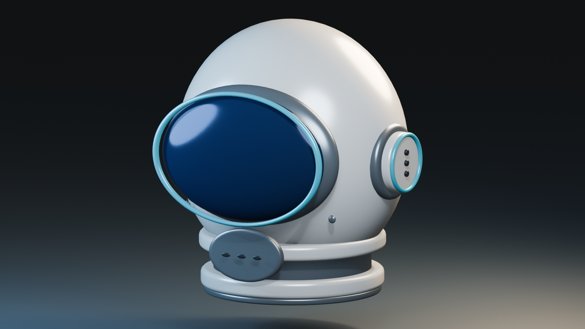

# Astronaut Helmet 3D Model

An editable, stylized astronaut helmet modeled in Blender — white shell with a dark blue visor, cyan trim rings, and side/chin port details.

## Files

| File | Description |
| --- | --- |
| `Astronaut_Helmet_Editable.blend` | Blender scene with the full editable model, materials and lighting |
| `Astronaut_Helmet_Preview.png` | Rendered preview of the helmet |
| `chatgpt-image.png` | AI-generated concept reference (ChatGPT) the model was based on |

## Reference

The model was built from this AI-generated concept image, made with ChatGPT:

## Usage

1. Open `Astronaut_Helmet_Editable.blend` in Blender.
2. Edit the mesh, materials, or lighting as needed.
3. Render or export from Blender (`File > Export`) to your target format.

## License

No license specified — all rights reserved by the author.
